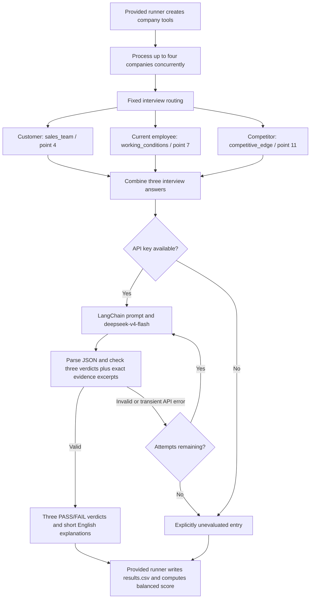

# FTEC5660 Homework 3: Fisher's 15-Point Investment Agent

Build a LangChain agent that researches a company with tools and applies the
framework from Philip Fisher's *Common Stocks and Uncommon Profits* (Part One,
Chapter 3 "What to buy: the fifteen points to look for in a common stock", and
Chapter 4 "What to buy: applying this to your own needs"). You choose 3 of
Fisher's 15 points and decide yourself what PASS means for each. For every
company your agent gives a PASS/FAIL verdict on your 3 points and a short
summary.

The companies are fictional, so the model cannot answer from memory. Unlike a
pile of reports, the evidence is spread over three sources, and your agent has
to go and get it with tools, the way Fisher's "scuttlebutt" method sends an
investor to talk to customers, competitors, suppliers and staff.

## Data and tools

`public_test/` has one folder per company. Your code receives four tools per
company (built by the provided code in `hw3.py`):

| Tool | What it gives you |
| --- | --- |
| `list_documents()` | the company's six documents and their dates |
| `read_document(name)` | one document: the 2025 letter to shareholders, four earnings calls (Q3 2025 to Q2 2026) and a news file (July 2025 to July 2026) |
| `sql_query(query)` | one read-only SQLite query on the company's database; at most 50 rows come back, so use `SUM`, `GROUP BY` and `WHERE` |
| `interview(role, topic)` | what one person says about the company; at most **10 interviews per company** |

The documents are what management says. Management's own claims (such as "we
have never cut research" or "our people are our greatest strength") are not
evidence on their own: check them against the database and the interviews.

**Database tables** (amounts in USD thousands; dates `YYYY-MM-DD`, months
`YYYY-MM`, quarters like `2025Q3`; the fiscal year is the calendar year):

| Table | Columns |
| --- | --- |
| `company` | name, industry |
| `industry_medians` | industry, revenue_growth_2y_pct, new_product_share_pct, new_product_sales_per_rd, operating_margin_pct (one row per industry; use the row for the company's own industry) |
| `orders` | order_id, order_date, product, customer, amount, note (about 3,000 to 4,000 orders from January 2023 to June 2026; revenue is the sum of order amounts) |
| `products` | product, launch_date |
| `monthly_costs` | month, cost_of_sales, selling_admin, research_development |
| `quarterly_cash` | quarter, operating_cash_flow, capex, cash_end |
| `capex_plan` | year, planned_capex (2026 to 2028) |
| `returns` | month, units_shipped, units_returned |
| `insider_trades` | trade_date, person, title, side (`buy` or `sell`), shares, price |

**Terms used in the data.**

| Term | Meaning |
| --- | --- |
| FY2025 | Fiscal year 2025. Here the fiscal year is the calendar year, so FY2025 is January to December 2025. |
| Quarter | Three months of the year: Q1 is January to March, Q2 April to June, Q3 July to September and Q4 October to December. The database writes `2025Q3`; the documents write "third quarter 2025". |
| Amounts | The database is in **USD thousands** (676,100 means US$676.1 million). The documents use USD millions. |
| Revenue | Money from sales: the sum of `amount` in `orders`. |
| Cost of sales | The cost of making the products that were sold. |
| Selling and admin | The cost of selling and of running the company (sales staff, offices, management). |
| R&D | Research and development spending, mainly on new products. |
| Operating margin | Operating profit as a share of revenue: (revenue − cost of sales − selling and admin − R&D) ÷ revenue. |
| Operating cash flow | Cash that the day-to-day business brings in during a quarter. |
| Cash at the end of a quarter | The cash the company holds on the last day of that quarter (`cash_end`). |
| Capex | Capital expenditure: spending on factories, machines and other long-term assets. `capex_plan` holds the planned capex for 2026 to 2028. |
| Return rate | Units returned ÷ units shipped, from the `returns` table. |
| Industry median | The middle value for companies in the same industry, from `industry_medians`. |
| Insider | A director or senior manager of the company. `insider_trades` lists the shares they bought (`buy`) or sold (`sell`). |
| Earnings call | A meeting each quarter where management presents the quarter's results to investors. Each call quotes that quarter's revenue. |

**Interviews.** Roles: `customer`, `current_employee`, `former_employee`,
`competitor`, `supplier`. Topics: `sales_team`, `working_conditions`,
`top_management`, `decision_making`, `competitive_edge`. Only some people know
about each topic; the others say they can't comment, and that answer still
uses up one interview.

| Topic | Who knows about it |
| --- | --- |
| `sales_team` | customer, competitor |
| `working_conditions` | current_employee, former_employee |
| `top_management` | former_employee, supplier |
| `decision_making` | supplier, customer |
| `competitive_edge` | competitor, customer |

People who know about a topic always agree with each other, so one good answer
is enough.

## Choose your 3 points and your rules

Pick any 3 of Fisher's 15 points and write them in `CHOSEN_POINTS` near the
top of `hw3.py`, e.g. `CHOSEN_POINTS = [1, 7, 15]`. The full questions are in
`FISHER_POINTS` in `hw3.py` and in the book.

| # | Fisher's point | Where the evidence is |
| --- | --- | --- |
| 1 | Market potential for sales growth | database |
| 2 | New products as current lines mature | database |
| 3 | Effective research and development | database |
| 4 | Above-average sales organization | interviews (`sales_team`) |
| 5 | Worthwhile profit margin | database |
| 6 | Maintaining or improving margins | database |
| 7 | Labour and personnel relations | interviews (`working_conditions`) |
| 8 | Executive relations | interviews (`top_management`) |
| 9 | Depth of management | interviews (`decision_making`) |
| 10 | Cost analysis and accounting controls | earnings calls, checked against the database |
| 11 | Advantage over competitors | interviews (`competitive_edge`) |
| 12 | Long-range outlook on profits | database |
| 13 | Growth without dilutive equity financing | database |
| 14 | Management talks freely about troubles | earnings calls, checked against the database |
| 15 | Management of unquestionable integrity | news file, checked against the database |

For each of your points, **you design the rule**: which evidence to use, what
to compute or whom to ask, and where the line between PASS and FAIL lies. PASS
means the company looks favourable on that point, as Fisher would see it.

We grade your verdicts against our own answer key. It uses one fixed rule per
point, which we do not publish, and the data never puts a company close to
the line of that rule, so a sensible reading of Fisher usually gives the same
answer. **Test your rules on the public answers**:
`public_test/ground_truth.json` gives the expected verdict on all 15 points
for each of the 20 public companies, and every point fails in 6 of them. If
your rule disagrees with the public answers, rethink it.

**Tip: calculate with tools, not in your head.** Do every sum, ratio and
comparison in SQL or Python, including the number of days between two dates
(SQLite's `julianday()` gives a date as a number of days).

## Student task

Fill in the three places in `hw3.py` marked `### YOUR CODE HERE`. You may add
imports, constants and helper functions above them, but do not change the
provided code below them:

- `CHOSEN_POINTS` lists your 3 points.
- `build_agent()` creates your model and anything else you need once.
- `analyze_companies(agent, companies)` receives
  `{company_folder: [list_documents, read_document, sql_query, interview]}`
  and returns, for every company,
  `{"points": {1: "PASS", 7: "FAIL", 15: "PASS"}, "summary": "..."}` (here with
  `CHOSEN_POINTS = [1, 7, 15]`).

Use the course techniques that fit your points: tool use for the database and
the interviews, planning which interviews to spend, routing each point to the
right source, prompt chaining, parallel calls, reflection to check your
answers, or a combination. Your code must read company data **only through
the four tools**; do not open `company.db` or `interviews.dat` yourself. Do
not hard-code folder names, company names or the public answers.

## Setup and public test

```bash
python3 -m venv .venv
source .venv/bin/activate
pip install -r requirements.txt
echo "DEEPSEEK_API_KEY=your_key_here" > .env
python3 hw3.py --data-folder public_test
```

Use your own DeepSeek API key (from https://platform.deepseek.com). The
required model is `deepseek-v4-flash`. We grade with our own key, so never put
a key in your code; `.env` must stay out of git.

The program creates `results.csv` with the columns `company`, `points`,
`points_correct`, `point_errors`, `interviews_used` and `summary`, and prints
the point score on your 3 points (the percentage after "balanced"). The point
score is the average of two shares: the share of truly passing verdicts that
you marked PASS and the share of truly failing verdicts that you marked FAIL.
For example, 90% and 60% give (90% + 60%) / 2 = 75%, and marking every point
PASS gives (100% + 0%) / 2 = 50%. Once `CHOSEN_POINTS` is set, the starter
runs before you add any API code (it returns no verdicts, so it scores 0%).

`public_test/ground_truth.json` gives the expected verdicts on all 15 points
for each public company. Grading uses a private set of about 20 unseen
companies with the same tools and the same answer key rules, but different
names and wording, and scores your 3 points only.

## Homework 3 solution

### My 3 points and rules

I chose points **4, 7 and 11** because each concerns observable behavior that can be assessed through a knowledgeable interviewee. This matches Fisher's scuttlebutt approach and avoids relying on management's self-description. The assignment states that informed interviewees agree, so one relevant interview per point is sufficient for this dataset.

| Point | Reason for selection | PASS rule | Evidence |
| --- | --- | --- | --- |
| **4: Sales organization** | Customers can describe the practical quality of sales support. | PASS when the customer reports knowledgeable and responsive support that helps solve operational problems or choose suitable products. FAIL when sales staff merely send prices, lack product knowledge, or provide inadequate support. | `interview(role="customer", topic="sales_team")` |
| **7: Labor and personnel relations** | Employees can describe working conditions and how grievances are handled. | PASS when the employee describes a constructive workplace with fair treatment, problems being addressed, or a stable team whose members want to stay. FAIL when poor morale, persistent excessive overtime, unresolved grievances, or repeated departures indicate weak relations. | `interview(role="current_employee", topic="working_conditions")` |
| **11: Competitive advantage** | A competitor can identify differentiation that is difficult to reproduce. | PASS when the competitor reports a meaningful defensible advantage, such as hard-to-copy know-how or an installed base, or persistent customer preference demonstrated by customers returning after trying rivals. FAIL when products are interchangeable or readily copied and competition is mainly on price. | `interview(role="competitor", topic="competitive_edge")` |

These rules are semantic criteria, not keyword matches. Negation and comparisons must be interpreted in context. A favorable answer on one point does not determine another point, and a positive verdict requires relevant evidence for that particular rule. A short exact excerpt and its role/topic accompany each verdict in `results.csv`.

### Design



The agent uses a fixed research plan and a LangChain prompt-model-parser chain. It calls the supplied interview tool directly for each relevant role/topic, then sends all three answers to `ChatDeepSeek` using the required `deepseek-v4-flash` model. The prompt asks the model to apply each rule independently, check its reasoning against the corresponding evidence, and return JSON. Python verifies the three literal verdicts, explanation lengths, and whether each quoted excerpt occurs in its matching interview. A malformed answer or transient request failure can trigger up to two retries using the same evidence, so retries do not consume additional interviews. Each company normally uses three interviews out of the allowed ten. Four companies can be processed concurrently; a company has a 180-second analysis limit, and the analysis stage has a 25-minute overall limit. API or tool failures produce explicit missing verdicts rather than fabricated investment conclusions. The supplied runner handles scoring after prediction; the agent does not read the answer key or open the underlying data files.

### Results

The authenticated public-test run on 4 November 2026 used Python 3.12.16 and the command `python hw3.py --data-folder public_test`. All 20 companies received three valid model verdicts and English explanations grounded in their interviews.

| Point | Correct true-PASS cases | Correct true-FAIL cases | Correct verdicts |
| --- | --- | --- | --- |
| 4 | 14/14 | 6/6 | 20/20 |
| 7 | 14/14 | 6/6 | 20/20 |
| 11 | 14/14 | 6/6 | 20/20 |
| **Total** | **42/42** | **18/18** | **60/60** |

The **balanced point score is 100.0%**, calculated as `(42/42 + 18/18) / 2`. Plain point accuracy is also 100.0%. There are **no companies with incorrect predictions** in this run, so there are no disagreement cases to explain. Every `point_errors` field is empty and every company has `points_correct = 3/3`.

The complete process took **24.03 seconds**, below the 30-minute limit; the analysis stage reported 21.66 seconds. Each company used exactly **3 interviews**, giving **60 interviews overall**, and none reached the ten-interview limit. The detailed verdicts and evidence excerpts are in `results.csv`. The requested API model was `deepseek-v4-flash`; the response identified the provider's current Flash service as `deepseek-flash`, consistent with the legacy-name behavior documented below.

The evidence review distinguishes responsive technical support from price-list selling, stable employee relations from repeated departures, and defensible differentiation from interchangeable products. For point 11, customers returning after trying rivals are treated as evidence of persistent customer preference, even when the interview does not name a technical barrier. These are general rules applied to interview meaning rather than company-specific exceptions. Public-test success does not establish performance on the unavailable private dataset or on future model versions.

### Running the solution

Use Python 3.10 or newer and install `requirements.txt`. Set `DEEPSEEK_API_KEY` in the environment or a local `.env` file, then run:

```bash
python hw3.py --data-folder public_test
```

An optional `DEEPSEEK_API_BASE` environment variable selects a compatible endpoint; the default is the official DeepSeek API. The request model remains `deepseek-v4-flash`. According to the [official model documentation](https://api-docs.deepseek.com/quick_start/pricing/), this legacy identifier is still accepted, but the provider now serves it with DeepSeek-V4.1-Flash-1017; the original V4 Flash backend has been retired. Keep `.env` out of version control and archives. To evaluate a private dataset, pass its directory to `--data-folder`; no company names or expected labels are configured in the agent.

## Task 2 Reflection

AI-sycophancy means agreeing with a user's preferred view even when the available evidence calls for doubt or disagreement. In an investment task, an agent could accept an optimistic narrative, reinterpret every interview positively, and make its conclusion sound more certain than the evidence allows. I would judge a useful assistant by the consistency of its evidence-based decisions, including whether the same evidence receives the same assessment when the user's stated preference changes. The Fisher agent therefore uses explicit criteria, separates the three judgments, and keeps quotations beside its conclusions.

I use AI-psychosis here as a non-clinical label for the concern that a conversation could reinforce a person's unfounded beliefs or encourage excessive reliance on an assistant. The label should not become a diagnosis or imply that an observed association proves causation. An assistant that treats speculation as established fact could create a feedback loop in which its own earlier statements are later mistaken for independent confirmation. I would prefer responses that acknowledge feelings without endorsing unsupported claims, clearly express uncertainty, and encourage independent checks and appropriate human support. Empathy and factual agreement are separate choices. In this homework, tracing conclusions back to external interview evidence is a small practical example of that distinction, although evidence excerpts alone cannot establish that an interpretation is correct.
